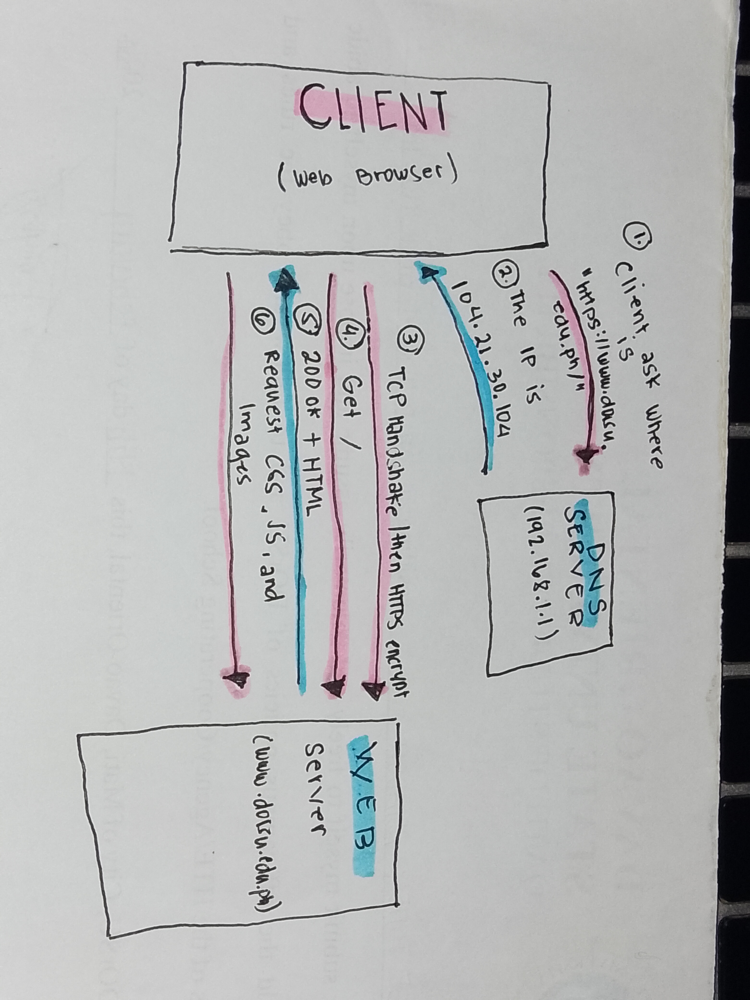

# URL Trace: www.dorsu.edu.ph

## DNS Lookup Output

```
Server:		192.168.1.1
Address:	192.168.1.1#53

Non-authoritative answer:
Name:	www.dorsu.edu.ph
Address: 104.21.30.104
Name:	www.dorsu.edu.ph
Address: 172.67.172.191
```


## The journey of a URL

### 1. The URL
I used the URL "https://www.dorsu.edu.ph/academics/programs" and "https://www.dorsu.edu.ph".
The Protocol for this URL is "https://". it tells the browser how to communicate with a website securely.
The Domain Name for this URL is "www.dorsu.edu.ph". This is the adrress or name of the website.
The Path for this URL is "/academics/programs". It identifies the specific page or location in the website

### 2. DNS lookup
Computers find each other using IP addresses, so the browser needs to translate the domain name into an IP address to connect to the website.
My browser asked the DNS server 192.168.1.1 to find the IP address of www.dorsu.edu.ph. The DNS server returned two IP addresses: 104.21.30.104 and 172.67.172.191.

### 3. Connection
After the browser has the IP address, it establishes a connection with the server through a TCP handshake, which is a three-step process that checks if both sides are ready to communicate. The "S" in HTTPS stands for "Secure", meaning the data exchanged between the browser and the website is encrypted, protecting personal information from people who might try to access it, such as someone using the same public Wi-Fi.

### 4. HTTP request
Once the connection is ready, the browser sends an HTTP request to the server, asking for the webpage using the GET method, which means it wants to receive the page. It requests the path / (the homepage) and identifies the website as www.dorsu.edu.ph using the Host field.

### 5. HTTP response
After the server receives the request, it sends back an HTTP response with a status code, where 200 OK means the request was successful and the browser can display the webpage. The response also contains headers, which provide additional information about the content, and a body, which contains the actual HTML code of the website.

### 6. Rendering
After the browser receives the HTML, it reads the code and builds the DOM (Document Object Model), which organizes the webpage elements, and the CSSOM (CSS Object Model), which organizes the styles like colors, fonts, and sizes. Next, the browser performs layout to determine the size and position of each element, then paint to draw everything on the screen. The browser also makes extra requests because the HTML contains links to other files, such as CSS, JavaScript, and images, that are needed to complete the webpage.

## Diagram



## Questions

### 1. Which computer is the client and which is the server?
In my trace, the client is my computer using the Google Chrome browser, which sends requests to access a website. The server is the computer hosting www.dorsu.edu.ph, which receives the requests and sends back the webpage.

### 2. What does the user see if the DNS lookup fails?
If the DNS lookup fails, the browser cannot find the IP address of the website, so it cannot connect to the server. The user may see an error message like "This site can't be reached" or DNS_PROBE_FINISHED_NXDOMAIN, meaning the domain name could not be found.

### 3. What is the difference between 200, 301 and 404?
200 OK – Means the request was successful and the webpage was loaded. Example: When I visit the DOrSU website and it displays correctly.

301 Moved Permanently – Means the webpage has permanently moved to a new address. Example: When an old website address automatically redirects me to its new address.

404 Not Found – Means the server cannot find the requested webpage. Example: When I open a broken or deleted link and the browser displays a "Page Not Found" message.